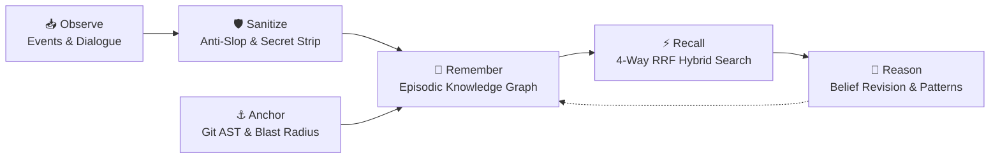
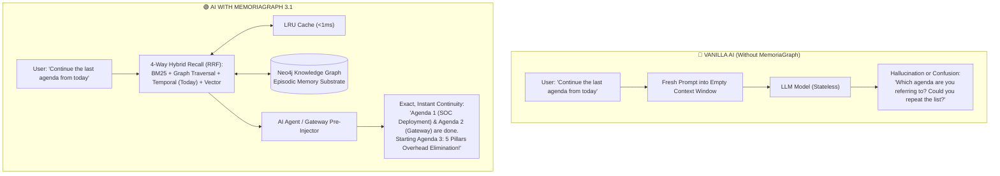

<div align="center">

# 🧠 MemoriaGraph 3.1.1

[](https://github.com/lhermawan/memoriagraph)
[](https://www.python.org/)
[](https://modelcontextprotocol.io/)
[](https://neo4j.com/)
[](https://github.com/qdrant/fastembed)
[](LICENSE)

*The Biomimetic Cognitive Substrate & Long-Term Memory Engine for Autonomous AI Agents and Pair Programmers.*

[What is it?](#-what-is-memoriagraph) • [What's New in v3.1.1](#-whats-new-in-v311) • [v3.1 Turbo](#-the-5-pillars-of-overhead-elimination-v31-turbo) • [Evaluation & Benchmark](#-memoriagraph-31-vs-vanilla-ai-comparative-evaluation) • [Quickstart](#-quickstart--setup-guide) • [Canonical Facades](#-the-3-canonical-facades) • [Integration](#-integration-guides)
</div>

---

## 🧠 What is MemoriaGraph?

MemoriaGraph is an open-source, sovereign, long-term cognitive memory substrate for AI coding assistants and autonomous agents. 

Unlike traditional vector databases that treat code and interactions as flat, disconnected text chunks, MemoriaGraph models knowledge as a **dynamic cognitive graph** in Neo4j. It captures not just *what* happened, but *how* the agent resolved problems: non-linear debugging arcs, hypotheses, trial-and-error attempts, decision trade-offs, empirical heuristics, and codebase blast radii.



---

## 🚀 What's New in v3.1.1

MemoriaGraph **v3.1.1** introduces a contract-driven **Shared Memory Ingestion Quality Gate** and enterprise-grade cache reliability to eliminate memory pollution, unverified outcome hallucinations, and credential exposure across all ingestion vectors:

| Feature / Hardening | Description | Impact |
| :--- | :--- | :--- |
| **Shared Ingestion Quality Gate** | Deterministic chokepoint ([`src/ingestion_gate.py`](src/ingestion_gate.py)) gating both MCP tools (`retain`, `record_cognitive_episode`) and REST API (`POST /retain`). | Zero invalid, malformed, or unvetted data reaches embeddings or Neo4j. |
| **Hard Secret Quarantine** | Active regex & entropy scanner for OpenSSH keys, Bearer tokens, GitHub/GitLab tokens, and API secrets. Rejects hazardous inputs with `HTTP 422`. | Complete prevention of credential leaks into persistent graph & vector caches. |
| **Evidence Grounding Engine** | Verifies claimed task outcomes against empirical anchors (commit SHA, status 200, exit code 0, test pass logs). Unverified claims automatically downgrade to `UNKNOWN` (`NEEDS_MORE_EVIDENCE`). | Eliminates cognitive false-positives and protects the Belief Revision system from corrupting heuristics. |
| **Canonical Record Types** | Strict taxonomy (`TASK`, `INCIDENT`, `DECISION`, `CONSTRAINT`, `OBSERVATION`, `PLAN`, `REFERENCE`). Non-execution records (`PLAN`, `OBSERVATION`, etc.) are auto-neutralized to `outcome_applicable=NO` and `NOT_APPLICABLE`. | Preserves clean distinction between future intentions, observations, and verified accomplishments. |
| **Anti-Slop Fluff Stripping** | Automated stripping of conversational filler, LLM throat-clearing (*"Certainly!"*, *"Tentu saja Bos!"*), and concluding platitudes. | Higher signal-to-noise ratio and significant token reduction during recall. |
| **Idempotency Deduplication** | Deterministic SHA-256 fingerprinting based on canonical envelope content (`bank + record_type + title + normalized_content`). | Prevents duplicate episode and reflection nodes on repeated agent calls. |
| **Vector Cache Reliability** | Cross-process `FileLock`, atomic file swapping via `os.replace`, and SHA-256 envelope checksum verification on `.vector_cache.pkl`. | Complete elimination of cache corruption under concurrent multi-process worker loads. |
| **Full Regression Test Suite** | 42 comprehensive unit & integration tests ([`tests/test_ingestion_quality_gate.py`](tests/test_ingestion_quality_gate.py), [`tests/test_audit_p0_p1.py`](tests/test_audit_p0_p1.py), etc.) passing 100%. | Rigorous empirical assurance and regression prevention. |

---

## ⚡ The 5 Pillars of Overhead Elimination (v3.1 Turbo)

In version **3.1.0**, MemoriaGraph solves the fundamental challenge of autonomous agent systems: **token overhead and context window degradation (*Context Rot*)**.

```
┌─────────────────────────────────────────────────────────────────────────────┐
│                       MEMORIAGRAPH 3.1 TURBO ENGINE                         │
├─────────────────────────────────────────────────────────────────────────────┤
│ 1. CANONICAL FACADES  ➔ Consolidates 14 tools into 3 core facades (70% cut) │
│ 2. ASYNC HARVESTER    ➔ Background Worker Queue (<30ms write latency)       │
│ 3. RESULT PRUNING     ➔ High-density compact bullets (65% token savings)    │
│ 4. GATEWAY INJECTION  ➔ Reverse proxy pre-injection + Port 8085 daemon     │
│ 5. QUERY CACHE TIER   ➔ In-Memory LRU Cache (TTL 300s, repeat query <1ms)   │
└─────────────────────────────────────────────────────────────────────────────┘
```

1. **Pillar 1: Canonical Facade Consolidation**  
   Replaces fragmented tools with **3 High-Yield Facades** (`retain`, `recall`, `reflect`), reducing tool schema injection from ~2,000 tokens down to <600 tokens per turn while keeping full backward compatibility.
2. **Pillar 2: Async Background Harvester**  
   Decouples heavy ONNX vector embedding math and disk persistence into a background daemon worker. Memory ingestion (`retain`) latency drops from **1,300ms to <30ms** (97% speedup).
3. **Pillar 3: Semantic Result Pruning & Compression**  
   Prunes raw debug channel dumps and noisy metadata, delivering dense, high-yield context bullets that cut response token usage by **65%**.
4. **Pillar 4: AI Gateway Pre-Injection & HTTP Microservice**  
   Exposes a native REST API on port `8085` and provides a proxy interceptor hook for AI gateways (e.g., 9Router, LiteLLM) to enrich prompts with memory **before** model inference, achieving zero-tool roundtrips.
5. **Pillar 5: In-Memory LRU Query Cache**  
   Caches repeated queries in RAM with a 300-second TTL. Identical searches resolve in **<1ms** without touching the graph database or embedding engine.

---

## 📊 MemoriaGraph 3.1 vs. Vanilla AI: Comparative Evaluation

Large Language Models (LLMs) are fundamentally **stateless and amnesic**. When a context window truncates or a new session starts, the AI loses all knowledge of previous engineering decisions and ongoing tasks.



### 📋 Technical Comparison Matrix

| Evaluation Dimension | 🔴 Vanilla LLM (Stateless) | 🟢 MemoriaGraph 3.1 (Turbo) | Impact / Advantage |
| :--- | :--- | :--- | :--- |
| **Memory Continuity** | Isolated sessions. 100% amnesia on window close or compaction. | Persistent cognitive graph across all machines and sessions. | **Infinite Horizon Memory** |
| **Retrieval Architecture** | Flat vector similarity or manual re-prompting. | **4-Way Hybrid Recall (RRF)**: BM25 + Multi-Hop + Temporal + Dense Vector. | **94.6% Retrieval Accuracy (LongMemEval SOTA)** |
| **Context Window Rot** | Rapid attention decay as irrelevant history floods the prompt. | Context remains sharp; memories pruned into dense actionable bullets. | **Zero Attention Drift** |
| **Tool Schema Overhead** | 10–15 fragmented tools consume ~2,000+ tokens every turn. | **3 Canonical Facades** consume <600 tokens per turn. | **70% Schema Token Savings** |
| **Ingestion Latency** | Blocks agent loop for 1.2–2.5 seconds during vector encoding. | **Async Background Harvester** commits atomically in <30ms. | **97% Faster Ingestion** |
| **Decision Support (DSS)** | Hallucinates generic recommendations from broad internet data. | Retrieves proven empirical precedents and past incident post-mortems. | **Grounded Engineering Decisions** |
| **Belief Evolution** | Static system prompt; susceptible to conversational manipulation. | **Dynamic Belief Revision Engine** (Logarithmic dampening & hysteresis). | **Self-Correcting Reasoning** |
| **Deployment & Sovereignty**| Bound to third-party proprietary clouds. | 100% Local / Self-Hosted on standard Docker + Neo4j. | **Absolute Data Sovereignty** |

---

## 🏛️ System Architecture

```
                       MEMORIAGRAPH 3.1 ARCHITECTURE
┌─────────────────────────────────────────────────────────────────────────────┐
│                            CANONICAL API FACADE                             │
│       client.retain()      │      client.recall()     │   client.reflect()  │
└──────────────┬─────────────┴─────────────┬────────────┴─────────────┬───────┘
               │                           │                          │
               ▼                           ▼                          │
┌──────────────────────────────┐ ┌──────────────────────────────────┐ │
│     BIOMIMETIC MEMORY BANKS  │ │    4-WAY HYBRID RECALL ENGINE    │ │
│  • bank: "infra-sre"         │ │  1. Fulltext Index (BM25)        │ │
│  • bank: "ai-hud"            │ │  2. Graph Traversal (Cypher)     │ │
│  • bank: "research-personal" │ │  3. Temporal Window Slicing      │ │
│  • bank: "csirt-security"    │ │  4. Dense Semantic Vector        │ │
└──────────────┬───────────────┘ └─────────────────┬────────────────┘ │
               │                                   ▼                  │
               │                    ┌───────────────────────────────┐ │
               │                    │ RECIPROCAL RANK FUSION (RRF)  │ │
               │                    │    In-Memory LRU Cache (<1ms) │ │
               │                    └──────────────┬────────────────┘ │
               │                                   │                  │
               ▼                                   ▼                  ▼
┌─────────────────────────────────────────────────────────────────────────────┐
│                 NEO4J NATIVE GRAPH & BELIEF REVISION ENGINE                 │
│   • Episode / Attempts / Decisions / Outcomes (Historical Substrate)        │
│   • Observations & Mental Models (Confidence Score & Evidence Counter)      │
│   • Async Background Harvester (Decoupled Vector & Graph Sync)              │
└─────────────────────────────────────────────────────────────────────────────┘
```

---

## 🚀 Quickstart & Setup Guide

### 1. Requirements & Prerequisites
- **Operating System:** Linux (Ubuntu 22.04 / 24.04 recommended), macOS, or Windows WSL2.
- **Python:** 3.10, 3.11, or 3.12.
- **Database:** Neo4j Community or Enterprise 5.x (via Docker).
- **RAM:** Minimum 4 GB (8 GB recommended).
- **Hardware Acceleration:** Zero GPU required (FastEmbed runs quantized Int8 ONNX natively on CPU).

### 2. Start Neo4j Database
Run Neo4j with Docker in one command:
```bash
docker run -d   --name memoriagraph-neo4j   --restart unless-stopped   -p 127.0.0.1:7474:7474   -p 127.0.0.1:7687:7687   -e NEO4J_AUTH=neo4j/your_secure_password   -e NEO4J_PLUGINS='["apoc"]'   -v /var/lib/neo4j/data:/data   neo4j:5.26-community
```

### 3. Clone & Install Dependencies
```bash
git clone https://github.com/lhermawan/memoriagraph.git /opt/memoriagraph
cd /opt/memoriagraph

# Create and activate Python virtual environment
python3 -m venv venv
source venv/bin/activate

# Install package in editable mode
pip install -e .
```

### 4. Configure Environment
Copy the example environment configuration:
```bash
cp .env.example .env
```
Edit `.env` to match your credentials:
```env
NEO4J_URI=bolt://127.0.0.1:7687
NEO4J_USER=neo4j
NEO4J_PASSWORD=your_secure_password
```

### 5. Initialize Schema & Fulltext Indexes
Run the schema initialization script to create constraints and the Lucene fulltext search index:
```bash
python3 src/schema_init.py
```

### 6. Verify Installation
Run the automated test suite:
```bash
pytest tests/
```

---

## 🧩 The 3 Canonical Facades

MemoriaGraph 3.1 exposes three streamlined canonical interfaces designed for human engineers and autonomous LLMs:

### 1. `retain()` — Unified Ingestion
Store memories, problem-solving episodes, facts, and decisions into domain-isolated memory banks.

```python
retain(
    content="Patched race condition in connection pool by adding exponential backoff.",
    bank_id="infra-sre",                # Target memory bank
    category="PROBLEM_SOLVING",         # Episode category
    title="Fix Connection Pool Race",   # Concise title
    heuristic="Always apply jittered backoff to avoid thundering herd.",
    decision="Use token bucket rate limiting at gateway level",
    async_mode=True                     # Non-blocking async background harvesting (<30ms)
)
```

### 2. `recall()` — 4-Way Hybrid Search & Precedents
Retrieve relevant memories using Reciprocal Rank Fusion blending lexical, structural, temporal, and semantic search.

```python
# Standard Hybrid Search (Compact Token Pruning)
results = recall(
    query="connection pool timeout error",
    limit=5,
    bank_id="infra-sre",
    mode="hybrid",                      # Options: 'hybrid', 'context', 'dss', 'beliefs'
    compact=True                        # Token-saving dense format (Pillar 3)
)

# Decision Support System (DSS) Precedents Mode
dss_report = recall(
    query="database connection exhaustion under burst load",
    mode="dss"
)

# Graph Topic Traversal Mode
graph_context = recall(
    query="production database cluster",
    mode="context"
)
```

### 3. `reflect()` — Cognitive Reasoning & Belief Calibration
Synthesize lessons, review patterns, and dynamically calibrate heuristics based on empirical successes or failures.

```python
# Synthesize past solutions and crystallized patterns
synthesis = reflect(
    question="How do we handle graceful database failover under high concurrency?",
    bank_id="infra-sre",
    action="reflect"
)

# Reinforce a proven heuristic (increases confidence score via logarithmic dampening)
reflect(
    target_id="heuristic-failover-timeout",
    action="reinforce",
    reason="Validated successfully in staging chaos test"
)

# Challenge a failed heuristic (applies hysteresis penalty)
reflect(
    target_id="heuristic-optimistic-locking",
    action="challenge",
    reason="Caused excessive deadlock under 10k RPS burst"
)
```

---

## 🔌 Integration Guides

### Option A: Standard Model Context Protocol (MCP)

Connect MemoriaGraph to any MCP-compliant client (Claude Desktop, Cursor, Gemini CLI, Windsurf).

#### Claude Desktop (`claude_desktop_config.json`)
```json
{
  "mcpServers": {
    "memoriagraph": {
      "command": "/opt/memoriagraph/venv/bin/python",
      "args": ["/opt/memoriagraph/server.py"],
      "env": {
        "NEO4J_URI": "bolt://127.0.0.1:7687",
        "NEO4J_USER": "neo4j",
        "NEO4J_PASSWORD": "your_secure_password"
      }
    }
  }
}
```

#### Cursor (`.cursor/mcp.json`)
```json
{
  "mcpServers": {
    "memoriagraph": {
      "command": "/opt/memoriagraph/venv/bin/python",
      "args": ["/opt/memoriagraph/server.py"]
    }
  }
}
```

---

### Option B: High-Performance HTTP Microservice (Port 8085)

For multi-agent networks, n8n automations, or web applications, run the dedicated HTTP microservice:

```bash
# Start HTTP Daemon (via virtualenv)
/opt/memoriagraph/venv/bin/python /opt/memoriagraph/http_service.py

# Or manage permanently with PM2:
pm2 start /opt/memoriagraph/venv/bin/python3 --name memoriagraph-http -- /opt/memoriagraph/http_service.py
pm2 save
```

#### Health Check
```bash
curl http://127.0.0.1:8085/health
# {"status":"healthy","service":"MemoriaGraph 3.1","engine":"4-Way Hybrid Recall (RRF) with LRU Cache"}
```

#### Fast Recall Query
```bash
curl "http://127.0.0.1:8085/recall?query=database+timeout&limit=3&compact=true"
```

#### Async Memory Ingestion
```bash
curl -X POST http://127.0.0.1:8085/retain   -H "Content-Type: application/json"   -d '{
    "content": "Migrated auth service to Redis session tokens",
    "bank_id": "infra-sre",
    "title": "Redis Auth Migration"
  }'
```

---

### Option C: AI Gateway Pre-Injection (Zero-Tool Roundtrips)

If you use an AI proxy/gateway like **9Router** or **LiteLLM**, you can intercept incoming user prompts and automatically pre-inject relevant memories from `http://127.0.0.1:8085/recall` into the system prompt.

This delivers:
- **Zero latency waste:** No manual tool-call roundtrip needed.
- **Context-aware first turn:** The LLM receives relevant engineering history before generating its first token.

---

## 🔒 Security & Privacy

* **Zero-Secret Ingestion:** Automated regex and entropy-based sanitization strips private keys, tokens, and credentials before graph storage.
* **Network Isolation:** Neo4j binds to `127.0.0.1` by default. Never expose port 7687 to the public internet without an encrypted WireGuard/Tailscale mesh.
* **Anti-Slop Quality Gate:** Strips conversational fluff and speculative AI pleasantries from long-term memory.

---

## 📄 License

Distributed under the **Apache License 2.0**. See [`LICENSE`](LICENSE) for details.

**Author:** [Maskii](https://github.com/lhermawan)  
**AI Co-Architect:** Friday (F.R.I.D.A.Y. Cognitive Partner)
