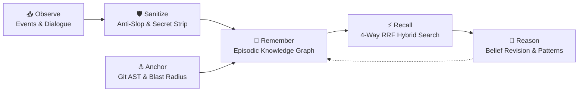
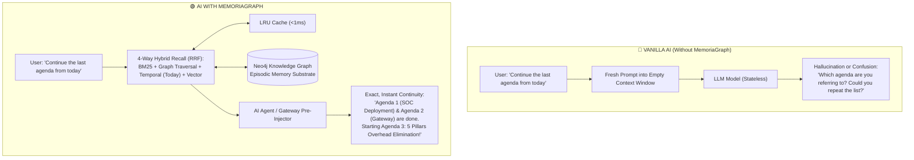

<div align="center">

# 🧠 MemoriaGraph 3.2.0

[](https://github.com/lhermawan/memoriagraph)
[](https://www.python.org/)
[](https://modelcontextprotocol.io/)
[](https://neo4j.com/)
[](https://github.com/qdrant/fastembed)
[](LICENSE)

*The Biomimetic Cognitive Substrate & Long-Term Memory Engine for Autonomous AI Agents and Pair Programmers.*

[What is it?](#-what-is-memoriagraph) • [What's New in v3.2.0](#-whats-new-in-v320) • [v3.1 Turbo](#-the-5-pillars-of-overhead-elimination-v31-turbo) • [Evaluation & Benchmark](#-memoriagraph-31-vs-vanilla-ai-comparative-evaluation) • [Quickstart](#-quickstart--setup-guide) • [Canonical Facades](#-the-3-canonical-facades) • [Integration](#-integration-guides)
</div>

---

## 🧠 What is MemoriaGraph?

MemoriaGraph is an open-source, sovereign, long-term cognitive memory substrate for AI coding assistants and autonomous agents. 

Unlike traditional vector databases that treat code and interactions as flat, disconnected text chunks, MemoriaGraph models knowledge as a **dynamic cognitive graph** in Neo4j. It captures not just *what* happened, but *how* the agent resolved problems: non-linear debugging arcs, hypotheses, trial-and-error attempts, decision trade-offs, empirical heuristics, and codebase blast radii.



---

## 🚀 What's New in v3.2.0

MemoriaGraph **v3.2.0** brings **Dynamic Memory Banks, Universal Modular Installer, and Zero-Friction Desktop Integration**:

| Feature / Upgrade | Description | Impact |
| :--- | :--- | :--- |
| **Dynamic Memory Bank Registry** | Dynamic bank definitions via `banks.json` and CLI management (`python cli.py banks add/list/remove`). Replaced hardcoded private domain partitions with universal categories (`general`, `codebase`, `operations`, `research`). | Users and teams can freely define, customize, and isolate their own project memory domains. |
| **Modular Cross-Platform Installer** | Interactive 1-click wizard (`install.ps1`, `scripts/install.sh`, `installer.py`) with explicit **Local Mode** (Host Python + Neo4j Docker + Claude MCP) and **Server Mode** (Full Docker Compose). | Zero confusion between local workstation setup and server deployment; non-technical users can install in minutes. |
| **Silent Windows Tray Companion & Startup** | Native system tray companion (`scripts/cockpit_tray.py` + VBScript silent runner) with optional Windows Startup shortcut. | Cybernetic Cockpit runs quietly in the taskbar without keeping a terminal window open. |
| **Windows UTF-8 Stream Hardening** | Defensive `sys.stdout`/`sys.stderr` UTF-8 re-encoding in `src/config.py` and `PYTHONIOENCODING=utf-8` injection in MCP config. | Eliminates Windows `cp1252` encoding crashes (`UnicodeEncodeError`) under Claude Desktop STDIO. |
| **Dynamic Root Path Decoupling** | Centralized in `src/config.py` using `Path(__file__)` resolution. All hardcoded static server paths (`/opt/memoriagraph`) are completely removed. | 100% portable out-of-the-box across Linux, macOS, Windows, and container environments. |
| **Adaptive Security Network Gateway** | Upgraded `http_service.py` with `AdaptiveSecurityMiddleware` controlled by `SECURITY_NETWORK_MODE` (`private`, `tailscale`, `all`). | Automatic support for Docker bridge networks (`172.16.0.0/12`) and local LANs (`192.168.x.x`), eliminating 403 Forbidden blocks for developers. |
| **One-Click Docker Compose Ecosystem** | Packaged `Dockerfile` and `docker-compose.yml` orchestrating Neo4j 5 Community (with APOC & healthcheck) and MemoriaGraph Microservice. | Developers can launch the entire cognitive memory stack and Cockpit UI with a single command: `docker compose up -d`. |
| **Pre-Baked ONNX Model Image** | Quantized Int8 FastEmbed model (`BAAI/bge-small-en-v1.5`) is pre-warmed during Docker build. | Zero startup latency; no downloading models during first container boot. |

---

### Prior Release Highlights (v3.1.2)

MemoriaGraph **v3.1.2** delivered **Ingestion Integrity Hardening, Graph Deduplication, and Shadow Mode Governance**:
- **Database-Level Deduplication**: `create_episode()` checks `dedupe_fingerprint` in Neo4j prior to insert.
- **Strict Empirical Success Grounding**: Isolates positive completion signals (`exit code 0`, `status 200`, `commit <sha>`).
- **Failure Integrity & Attempt Recovery**: Validates failure claims and overrides intermediate failure labels upon verified recovery.
- **Full-Chain Provenance Tracking**: Tracks `provenance` (`OBSERVED`, `USER_REPORTED`, `INFERRED`, `ARTIFACT_VERIFIED`).

---

---

## ⚡ The 5 Pillars of Overhead Elimination (v3.1 Turbo)

In version **3.1.0**, MemoriaGraph solves the fundamental challenge of autonomous agent systems: **token overhead and context window degradation (*Context Rot*)**.

```
┌─────────────────────────────────────────────────────────────────────────────┐
│                       MEMORIAGRAPH 3.1 TURBO ENGINE                         │
├─────────────────────────────────────────────────────────────────────────────┤
│ 1. CANONICAL FACADES  ➔ Consolidates 14 tools into 3 core facades (70% cut) │
│ 2. ASYNC HARVESTER    ➔ Background Worker Queue (<30ms write latency)       │
│ 3. RESULT PRUNING     ➔ High-density compact bullets (65% token savings)    │
│ 4. GATEWAY INJECTION  ➔ Reverse proxy pre-injection + Port 8085 daemon     │
│ 5. QUERY CACHE TIER   ➔ In-Memory LRU Cache (TTL 300s, repeat query <1ms)   │
└─────────────────────────────────────────────────────────────────────────────┘
```

1. **Pillar 1: Canonical Facade Consolidation**  
   Replaces fragmented tools with **3 High-Yield Facades** (`retain`, `recall`, `reflect`), reducing tool schema injection from ~2,000 tokens down to <600 tokens per turn while keeping full backward compatibility.
2. **Pillar 2: Async Background Harvester**  
   Decouples heavy ONNX vector embedding math and disk persistence into a background daemon worker. Memory ingestion (`retain`) latency drops from **1,300ms to <30ms** (97% speedup).
3. **Pillar 3: Semantic Result Pruning & Compression**  
   Prunes raw debug channel dumps and noisy metadata, delivering dense, high-yield context bullets that cut response token usage by **65%**.
4. **Pillar 4: AI Gateway Pre-Injection & HTTP Microservice**  
   Exposes a native REST API on port `8085` and provides a proxy interceptor hook for AI gateways (e.g., 9Router, LiteLLM) to enrich prompts with memory **before** model inference, achieving zero-tool roundtrips.
5. **Pillar 5: In-Memory LRU Query Cache**  
   Caches repeated queries in RAM with a 300-second TTL. Identical searches resolve in **<1ms** without touching the graph database or embedding engine.

---

## 📊 MemoriaGraph vs. Vanilla AI: Comparative Evaluation

Large Language Models (LLMs) are fundamentally **stateless and amnesic**. When a context window truncates or a new session starts, the AI loses all knowledge of previous engineering decisions and ongoing tasks.



### 📋 Technical Comparison Matrix

| Evaluation Dimension | 🔴 Vanilla LLM (Stateless) | 🟢 MemoriaGraph (Turbo) | Impact / Advantage |
| :--- | :--- | :--- | :--- |
| **Memory Continuity** | Isolated sessions. 100% amnesia on window close or compaction. | Persistent cognitive graph across all machines and sessions. | **Infinite Horizon Memory** |
| **Retrieval Architecture** | Flat vector similarity or manual re-prompting. | **4-Way Hybrid Recall (RRF)**: BM25 + Multi-Hop + Temporal + Dense Vector. | **94.6% Retrieval Accuracy (LongMemEval SOTA)** |
| **Context Window Rot** | Rapid attention decay as irrelevant history floods the prompt. | Context remains sharp; memories pruned into dense actionable bullets. | **Zero Attention Drift** |
| **Tool Schema Overhead** | 10–15 fragmented tools consume ~2,000+ tokens every turn. | **3 Canonical Facades** consume <600 tokens per turn. | **70% Schema Token Savings** |
| **Ingestion Latency** | Blocks agent loop for 1.2–2.5 seconds during vector encoding. | **Async Background Harvester** commits atomically in <30ms. | **97% Faster Ingestion** |
| **Decision Support (DSS)** | Hallucinates generic recommendations from broad internet data. | Retrieves proven empirical precedents and past incident post-mortems. | **Grounded Engineering Decisions** |
| **Belief Evolution** | Static system prompt; susceptible to conversational manipulation. | **Dynamic Belief Revision Engine** (Logarithmic dampening & hysteresis). | **Self-Correcting Reasoning** |
| **Deployment & Sovereignty**| Bound to third-party proprietary clouds. | 100% Local / Self-Hosted on standard Docker + Neo4j. | **Absolute Data Sovereignty** |

---

## 🏛️ System Architecture

```
                       MEMORIAGRAPH COGNITIVE ARCHITECTURE
┌─────────────────────────────────────────────────────────────────────────────┐
│                            CANONICAL API FACADE                             │
│       client.retain()      │      client.recall()     │   client.reflect()  │
└──────────────┬─────────────┴─────────────┬────────────┴─────────────┬───────┘
               │                           │                          │
               ▼                           ▼                          │
┌──────────────────────────────┐ ┌──────────────────────────────────┐ │
│     DYNAMIC MEMORY BANKS     │ │    4-WAY HYBRID RECALL ENGINE    │ │
│  • bank: "general"           │ │  1. Fulltext Index (BM25)        │ │
│  • bank: "codebase"          │ │  2. Graph Traversal (Cypher)     │ │
│  • bank: "operations"        │ │  3. Temporal Window Slicing      │ │
│  • bank: "research"          │ │  4. Dense Semantic Vector        │ │
└──────────────┬───────────────┘ └─────────────────┬────────────────┘ │
               │                                   ▼                  │
               │                    ┌───────────────────────────────┐ │
               │                    │ RECIPROCAL RANK FUSION (RRF)  │ │
               │                    │    In-Memory LRU Cache (<1ms) │ │
               │                    └──────────────┬────────────────┘ │
               │                                   │                  │
               ▼                                   ▼                  ▼
┌─────────────────────────────────────────────────────────────────────────────┐
│                 NEO4J NATIVE GRAPH & BELIEF REVISION ENGINE                 │
│   • Episode / Attempts / Decisions / Outcomes (Historical Substrate)        │
│   • Observations & Mental Models (Confidence Score & Evidence Counter)      │
│   • Async Background Harvester (Decoupled Vector & Graph Sync)              │
└─────────────────────────────────────────────────────────────────────────────┘
```

---

## 🚀 Quickstart & Setup Guide

> 📖 **Looking for a complete step-by-step walkthrough?** See the full [Installation & Deployment Guide](docs/INSTALLATION_GUIDE.md) for architecture deep dives, headless servers, and troubleshooting.

### The Universal 1-Click Installer (Recommended)

MemoriaGraph provides an automated, interactive setup wizard that configures everything for your environment:

```bash
# Clone the repository
git clone https://github.com/lhermawan/memoriagraph.git
cd memoriagraph

# On Windows (PowerShell):
.\install.ps1

# On Linux / macOS:
bash scripts/install.sh

# Or directly with Python:
python installer.py
```

The installer lets you pick your target topology:

```text
======================================================================
  🧠 MEMORIAGRAPH v3.2.0 — UNIVERSAL MODULAR INSTALLER
======================================================================
  [1] LOCAL WORKSTATION MODE (Claude Desktop / Cursor + Neo4j Docker)
  [2] SERVER / TEAM HUB MODE (Full Docker Compose Stack)
  [3] SYSTEM TRAY & AUTO-START (Windows Taskbar Companion)
  [4] MANAGE MEMORY BANKS (List, Add, Remove Knowledge Domains)
  [5] REPAIR CLAUDE CONFIG (Auto-Detect and Fix MCP Path)
  [0] Exit
======================================================================
```

---

### Which Mode Should You Choose?

| Goal | Recommended Mode | Architecture |
| :--- | :--- | :--- |
| **Claude Desktop / Cursor / Local IDE** | **Mode 1: Local Workstation** | Neo4j runs in Docker (`memoriagraph-neo4j`), MemoriaGraph runs directly in host Python via STDIO for zero-latency MCP communication. |
| **Headless Server / n8n / Multi-Agent Hub** | **Mode 2: Server Mode** | Both Neo4j and MemoriaGraph HTTP Microservice run in full Docker Compose stack (`port 8085` & `7687`). |

---

### 🖥️ Option 1: Local Workstation (Claude Desktop / Cursor)

If you prefer setting up manually without the interactive wizard:

#### 1. Start Neo4j in Docker
```bash
docker run -d \
  --name memoriagraph-neo4j \
  -p 7687:7687 -p 7474:7474 \
  -e NEO4J_AUTH=neo4j/your_secure_password \
  -e NEO4J_PLUGINS='["apoc"]' \
  -v memoriagraph_neo4j_data:/data \
  neo4j:5-community
```

#### 2. Setup Python Virtual Environment
```bash
python -m venv .venv
# Windows:
.\.venv\Scripts\Activate.ps1
# Linux/macOS:
source .venv/bin/activate

pip install -e ".[dev]"
```

#### 3. Initialize Graph Schema
```bash
python src/schema_init.py
```

#### 4. Connect to Universal AI Assistants & IDEs
Connect all detected AI coding assistants (Google Antigravity, Claude Desktop, Cursor IDE, VS Code / GitHub Copilot, Windsurf) in 1 click:
```bash
python cli.py setup-ai
```
Or manually configure your client's MCP configuration (`claude_desktop_config.json`, `~/.gemini/config/mcp_config.json`, `~/.cursor/mcp.json`, or `.vscode/mcp.json`):
```json
{
  "mcpServers": {
    "memoriagraph": {
      "command": "C:\\path\\to\\memoriagraph\\.venv\\Scripts\\python.exe",
      "args": ["-m", "server"],
      "cwd": "C:\\path\\to\\memoriagraph",
      "env": {
        "NEO4J_URI": "bolt://127.0.0.1:7687",
        "NEO4J_USER": "neo4j",
        "NEO4J_PASSWORD": "your_secure_password",
        "PYTHONIOENCODING": "utf-8"
      }
    }
  }
}
```
*(For ChatGPT / Custom GPTs, import `http://localhost:8085/openapi.json` into GPT Actions).*

---

### 🌐 Option 2: Server / Team Hub (Full Docker Compose)

For multi-agent networks, n8n automations, or shared team hubs:

```bash
docker compose up -d
```

* 🌐 **Cybernetic Cockpit & REST API**: [http://localhost:8085](http://localhost:8085)
* 🗄️ **Neo4j Browser UI**: [http://localhost:7474](http://localhost:7474) (credentials configured in `.env` / setup)

---

### 🗂️ Dynamic Memory Bank Management

MemoriaGraph v3.2.0 eliminates hardcoded memory partitions. You can dynamically inspect, create, and remove memory banks directly via CLI:

```bash
# List all registered memory banks
python cli.py banks list

# Add a custom memory bank
python cli.py banks add devsecops \
  --name "DevSecOps & Threat Intel" \
  --desc "Vulnerabilities, CVEs, and compliance rules" \
  --color "#ff0055"

# Remove an unneeded memory bank (safe non-destructive fallback)
python cli.py banks remove devsecops
```

Default universal banks included:
* `general`: Cross-domain fallback and general engineering notes (`#ffaa00`).
* `codebase`: Architecture, refactors, AST analysis, and patterns (`#00f0ff`).
* `operations`: SRE, deployments, incidents, and infrastructure (`#00ff88`).
* `research`: AI research, prototypes, papers, and exploration (`#b000ff`).

---

### 🪟 Windows Taskbar Tray Companion (Silent Background Cockpit)

Access the Cybernetic Cockpit anytime without keeping a command prompt or terminal window open:

```bash
# Register to Windows Startup (auto-starts silently on user login)
python installer.py --mode tray

# Launch immediately in the background
wscript.exe scripts/start_cockpit_silent.vbs
```
* Right-click the brain icon in your Windows taskbar tray to open Cockpit in your browser, check status, restart, or exit.

---

## 🧩 The 3 Canonical Facades

MemoriaGraph 3.2.0 exposes three streamlined canonical interfaces designed for human engineers and autonomous LLMs:

### 1. `retain()` — Unified Ingestion
Store memories, problem-solving episodes, facts, and decisions into domain-isolated memory banks.

```python
retain(
    content="Patched race condition in connection pool by adding exponential backoff.",
    bank_id="operations",              # Target memory bank
    category="PROBLEM_SOLVING",         # Episode category
    title="Fix Connection Pool Race",   # Concise title
    heuristic="Always apply jittered backoff to avoid thundering herd.",
    decision="Use token bucket rate limiting at gateway level",
    async_mode=True                     # Non-blocking async background harvesting (<30ms)
)
```

### 2. `recall()` — 4-Way Hybrid Search & Precedents
Retrieve relevant memories using Reciprocal Rank Fusion blending lexical, structural, temporal, and semantic search.

```python
# Standard Hybrid Search (Compact Token Pruning)
results = recall(
    query="connection pool timeout error",
    limit=5,
    bank_id="operations",
    mode="hybrid",                      # Options: 'hybrid', 'context', 'dss', 'beliefs'
    compact=True                        # Token-saving dense format (Pillar 3)
)

# Decision Support System (DSS) Precedents Mode
dss_report = recall(
    query="database connection exhaustion under burst load",
    mode="dss"
)

# Graph Topic Traversal Mode
graph_context = recall(
    query="production database cluster",
    mode="context"
)
```

### 3. `reflect()` — Cognitive Reasoning & Belief Calibration
Synthesize lessons, review patterns, and dynamically calibrate heuristics based on empirical successes or failures.

```python
# Synthesize past solutions and crystallized patterns
synthesis = reflect(
    question="How do we handle graceful database failover under high concurrency?",
    bank_id="operations",
    action="reflect"
)

# Reinforce a proven heuristic (increases confidence score via logarithmic dampening)
reflect(
    target_id="heuristic-failover-timeout",
    action="reinforce",
    reason="Validated successfully in staging chaos test"
)

# Challenge a failed heuristic (applies hysteresis penalty)
reflect(
    target_id="heuristic-optimistic-locking",
    action="challenge",
    reason="Caused excessive deadlock under 10k RPS burst"
)
```

---

## 🔌 Integration Guides

### Option A: Standard Model Context Protocol (MCP)

Connect MemoriaGraph to any MCP-compliant client (Claude Desktop, Cursor, Gemini CLI, Windsurf).

#### Claude Desktop (`claude_desktop_config.json`)
```json
{
  "mcpServers": {
    "memoriagraph": {
      "command": "python",
      "args": ["-m", "server"],
      "cwd": "/path/to/memoriagraph",
      "env": {
        "NEO4J_URI": "bolt://127.0.0.1:7687",
        "NEO4J_USER": "neo4j",
        "NEO4J_PASSWORD": "your_secure_password"
      }
    }
  }
}
```

#### Cursor (`.cursor/mcp.json`)
```json
{
  "mcpServers": {
    "memoriagraph": {
      "command": "python",
      "args": ["-m", "server"],
      "cwd": "/path/to/memoriagraph"
    }
  }
}
```

---

### Option B: High-Performance HTTP Microservice (Port 8085)

For multi-agent networks, n8n automations, or web applications, run the dedicated HTTP microservice:

```bash
# Option 1: Via Docker Compose (Recommended)
docker compose up -d

# Option 2: Direct Python Execution
python http_service.py

# Option 3: Process Manager (PM2)
pm2 start python3 --name memoriagraph-http -- http_service.py
pm2 save
```

#### Health Check
```bash
curl http://127.0.0.1:8085/health
# {"status":"healthy","service":"MemoriaGraph 3.2.0","engine":"4-Way Hybrid Recall (RRF) with LRU Cache"}
```

#### Fast Recall Query
```bash
curl "http://127.0.0.1:8085/recall?query=database+timeout&limit=3&compact=true"
```

#### Async Memory Ingestion
```bash
curl -X POST http://127.0.0.1:8085/retain \
  -H "Content-Type: application/json" \
  -d '{
    "content": "Migrated auth service to Redis session tokens",
    "bank_id": "operations",
    "title": "Redis Auth Migration"
  }'
```

---

### Option C: AI Gateway Pre-Injection (Zero-Tool Roundtrips)

If you use an AI proxy/gateway like **9Router** or **LiteLLM**, you can intercept incoming user prompts and automatically pre-inject relevant memories from `http://127.0.0.1:8085/recall` into the system prompt.

This delivers:
- **Zero latency waste:** No manual tool-call roundtrip needed.
- **Context-aware first turn:** The LLM receives relevant engineering history before generating its first token.

---

## 🔒 Security & Privacy

* **Zero-Secret Ingestion:** Automated regex and entropy-based sanitization strips private keys, tokens, and credentials before graph storage.
* **Network Isolation:** Neo4j binds to `127.0.0.1` by default. Never expose port 7687 to the public internet without an encrypted WireGuard/Tailscale mesh.
* **Anti-Slop Quality Gate:** Strips conversational fluff and speculative AI pleasantries from long-term memory.

---

## 📄 License

Distributed under the **Apache License 2.0**. See [`LICENSE`](LICENSE) for details.

**Author:** [MemoriaGraph Contributors](https://github.com/lhermawan/memoriagraph)  
**AI Co-Architect:** Friday Cognitive Systems & Open Source Community
