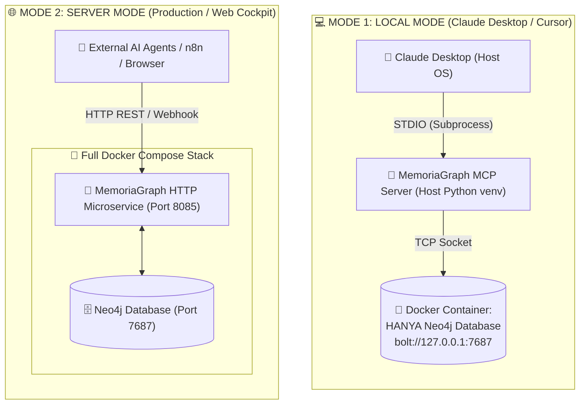

# 🧠 MemoriaGraph 3.2.0 — Panduan Instalasi & Setup Lengkap (Universal Guide)

> **Panduan resmi untuk pengguna awam dan perekayasa perangkat lunak.**  
> MemoriaGraph 3.2.0 dirancang 100% portabel, modular, dan mudah dihubungkan ke AI Assistant (Claude Desktop, Cursor IDE) baik menggunakan Docker maupun tanpa Docker.

---

## 📑 Daftar Isi
1. [Memahami 2 Mode Utama (Local vs Server)](#1-memahami-2-mode-utama)
2. [Skenario 1: Local Mode (Rekomendasi Laptop/PC Kerja)](#2-skenario-1-local-mode-rekomendasi-laptop-pc)
3. [Skenario 2: Server Mode (Full Docker Stack)](#3-skenario-2-server-mode-full-docker-stack)
4. [Menghubungkan ke Claude Desktop / AI Client](#4-menghubungkan-ke-claude-desktop--ai-client)
5. [Taskbar Tray Companion & Windows Auto-Startup](#5-taskbar-tray-companion--windows-auto-startup)
6. [Mengelola Kategori Memory Bank (Dinamis)](#6-mengelola-kategori-memory-bank-dinamis)
7. [Troubleshooting & Solusi Masalah Umum](#7-troubleshooting--solusi-masalah-umum)

---

## 1. Memahami 2 Mode Utama

MemoriaGraph menyediakan dua mode operasi yang disesuaikan dengan kebutuhan Anda:



| Fitur / Pertimbangan | 💻 Mode 1: Local Mode | 🌐 Mode 2: Server Mode |
| :--- | :--- | :--- |
| **Tujuan Penggunaan** | AI Pair Programming harian di laptop/PC pribadi. | Server kantor/cloud, multi-agent, n8n webhook, Web Cockpit. |
| **Koneksi ke Claude Desktop** | **Sangat Mudah & Cepat (<1ms)** via STDIO lokal. | Memerlukan reverse proxy / bridge HTTP jika dari luar. |
| **Apa yang di Docker?** | **Hanya Neo4j Database** (container ringan, data persisten). | **Seluruh Stack** (Neo4j + MemoriaGraph HTTP port 8085). |
| **Kebutuhan Terminal** | Tidak perlu! Tersedia Taskbar Tray Icon. | Berjalan di latar belakang via Docker daemon. |

---

## 2. Skenario 1: Local Mode (Rekomendasi Laptop / PC)

Ini adalah cara termudah dan paling direkomendasikan bagi pengguna **Claude Desktop** atau **Cursor IDE**.

### Langkah Cepat (1-Klik):

#### Di Windows:
1. Pastikan Anda sudah menginstal **Python 3.10+** (pastikan mencentang *"Add Python to PATH"* saat instalasi).
2. Buka folder `memoriagraph`.
3. Klik kanan pada file **`install.ps1`** lalu pilih **"Run with PowerShell"** (atau jalankan `.\install.ps1` di PowerShell).
4. Pilih **`[1] LOCAL MODE`**.
5. Installer pintar akan:
   - Membuat virtual environment `.venv` secara otomatis.
   - Menginstal seluruh dependensi.
   - Mendeteksi Docker. Jika Neo4j belum jalan, installer akan menyalakan container `memoriagraph-neo4j` secara otomatis.
   - Menginisialisasi skema database Neo4j.
   - **Mendeteksi Claude Desktop dan otomatis mengonfigurasi MCP server.**
   - Menawarkan opsi Taskbar Tray Companion & Windows Auto-Startup.
6. **Selesai!** Cukup buka atau restart Claude Desktop Anda.

#### Di macOS / Linux:
1. Buka Terminal di folder repository.
2. Jalankan perintah:
   ```bash
   ./scripts/install.sh
   ```
3. Pilih **`[1] LOCAL MODE`** dan ikuti panduan interaktif di layar.

---

## 3. Skenario 2: Server Mode (Full Docker Stack)

Jika Anda ingin menjalankan MemoriaGraph di server, VM headless (`vm-maskii`), atau hanya ingin menggunakan Web Cockpit di browser tanpa Claude Desktop:

### Langkah Instalasi:
1. Pastikan Docker dan Docker Compose telah terpasang.
2. Jalankan installer dan pilih **`[2] SERVER MODE`**, atau langsung ketik:
   ```bash
   docker compose up -d
   ```
3. Akses layanan:
   * 🌐 **Cybernetic Cockpit & REST API**: [http://localhost:8085](http://localhost:8085)
   * 🗄️ **Neo4j Browser UI**: [http://localhost:7474](http://localhost:7474) (`user: neo4j`, `pass: memoriagraph_pass`)
   * 🔌 **Bolt Gateway**: `bolt://localhost:7687`

---

## 4. Menghubungkan ke Universal AI Assistant & IDE

MemoriaGraph v3.2.0 mendukung integrasi multi-AI secara universal tanpa perlu menyalin konfigurasi JSON manual satu per satu:

```
┌────────────────────────────────────────────────────────────────────────┐
│               MEMORIAGRAPH UNIVERSAL MULTI-AI ECOSYSTEM                │
├────────────────────────────────────────────────────────────────────────┤
│ • Google Antigravity ➔ ~/.gemini/config/mcp_config.json                │
│ • Claude Desktop     ➔ %APPDATA%/Claude/claude_desktop_config.json     │
│ • Cursor IDE         ➔ ~/.cursor/mcp.json & .cursor/mcp.json           │
│ • VS Code & Copilot  ➔ .vscode/mcp.json                                │
│ • Windsurf IDE       ➔ ~/.codeium/windsurf/mcp_config.json             │
│ • ChatGPT Custom GPT ➔ OpenAPI 3.1.0 (http://localhost:8085/openapi)   │
└────────────────────────────────────────────────────────────────────────┘
```

### A. Otomatis 1-Klik (Sangat Direkomendasikan)
Cukup jalankan perintah CLI berikut:
```bash
python cli.py setup-ai
```
Atau melalui installer interaktif:
* Pilih opsi **`[5] Hubungkan AI Assistant`**
* Tekan **`[A]`** untuk **Hubungkan SEMUA Client Terdeteksi Sekaligus**. Installer akan memindai AI assistant yang terpasang di komputer Anda, membuat backup aman (`.bak.<timestamp>`), dan mendaftarkan `mcpServers.memoriagraph` secara otomatis.

---

### B. Konfigurasi Manual per AI Assistant

#### 1. Google Antigravity
File konfigurasi: `~/.gemini/config/mcp_config.json`
```json
{
  "mcpServers": {
    "memoriagraph": {
      "command": "C:\\path\\to\\memoriagraph\\.venv\\Scripts\\python.exe",
      "args": ["server.py"],
      "cwd": "C:\\path\\to\\memoriagraph",
      "env": {
        "PYTHONIOENCODING": "utf-8",
        "NEO4J_URI": "bolt://127.0.0.1:7687",
        "NEO4J_USER": "neo4j",
        "NEO4J_PASSWORD": "memoriagraph_pass"
      }
    }
  }
}
```

#### 2. Anthropic Claude Desktop
File konfigurasi:
* **Windows**: `%APPDATA%\Claude\claude_desktop_config.json`
* **macOS**: `~/Library/Application Support/Claude/claude_desktop_config.json`
* **Linux**: `~/.config/Claude/claude_desktop_config.json`

*(Format JSON sama dengan Antigravity di atas)*

#### 3. Cursor IDE
File konfigurasi: `~/.cursor/mcp.json` (Global) atau `.cursor/mcp.json` (Project)

#### 4. VS Code & GitHub Copilot
File konfigurasi: `.vscode/mcp.json` dalam workspace project Anda.

#### 5. Windsurf IDE (Codeium)
File konfigurasi: `~/.codeium/windsurf/mcp_config.json`

---

### C. ChatGPT Custom Actions & OpenAI REST Integration

Untuk menghubungkan **ChatGPT Plus/Team/Enterprise** ke MemoriaGraph:
1. Pastikan Server Mode atau HTTP service berjalan di port `8085` (`docker compose up -d` atau `python http_service.py`).
2. Buka **ChatGPT** -> **Explore GPTs** -> **Create a GPT** -> Tab **Configure**.
3. Gulir ke bawah ke bagian **Actions** -> Klik **Create new action**.
4. Di bagian **Schema**, klik **Import from URL** lalu masukkan URL skema OpenAPI MemoriaGraph:
   ```
   http://localhost:8085/openapi.json
   ```
   *(Atau gunakan Tailscale / Domain URL publik jika diakses dari luar jaringan lokal)*.
5. ChatGPT sekarang memiliki kemampuan kognitif `recall`, `retain`, dan `health` secara instan!

---

## 5. Taskbar Tray Companion & Windows Auto-Startup

Bagi pengguna awam, melihat visualisasi memori graf (Cybernetic Cockpit) kini tidak lagi memerlukan jendela terminal hitam yang mengganggu:

### Fitur Taskbar Tray:
* **Icon Otak Neon** standby di System Tray (pojok kanan bawah dekat jam).
* **Klik Kanan / Klik 2x**:
  * 🌐 **Buka Cockpit (Browser)**: Membuka visualisasi 3D graph di browser default.
  * 📊 **Status Service**: Menampilkan info port dan PID.
  * 🔄 **Restart Service**: Memuat ulang service jika diperlukan.
  * ❌ **Matikan & Keluar**.
* **Menjalankan Tray Manual**:
  ```bash
  python scripts/cockpit_tray.py
  ```
* **Menjalankan 100% Senyap (Tanpa Terminal Hitam)**:
  Klik ganda pada file `scripts/start_cockpit_silent.vbs`.

---

## 6. Mengelola Kategori Memory Bank (Dinamis)

MemoriaGraph v3.2.0 tidak mengunci kategori memori ke bidang tertentu. Anda bebas menambah atau menghapus kategori memory bank melalui file `banks.json` atau melalui CLI.

### Default Universal Banks:
1. `general`: Catatan percakapan umum dan tugas harian bebas.
2. `codebase`: Arsitektur kode, bug fixing, refactoring, dan git changes.
3. `operations`: DevOps, Docker, server, deployment, dan monitoring.
4. `research`: Riset teknologi, paper, benchmark, dan prototype.

### Perintah CLI Memory Bank:
```bash
# Melihat daftar bank aktif
python cli.py banks list

# Menambah bank kustom baru
python cli.py banks add marketing --name "Marketing & Socials" --desc "Riset kampanye iklan dan analitik"

# Menghapus bank kustom
python cli.py banks remove marketing
```

---

## 7. Troubleshooting & Solusi Masalah Umum

### Q1: Claude Desktop menampilkan pesan "Failed to connect to MCP server"
* **Penyebab 1:** Database Neo4j belum menyala.
  * **Solusi:** Jika menggunakan Docker, jalankan `docker start memoriagraph-neo4j`. Jika native, pastikan Neo4j Desktop dalam status *Active*.
* **Penyebab 2:** Error encoding karakter Windows CP1252.
  * **Solusi:** Di MemoriaGraph v3.2.0, issue ini telah diperbaiki secara permanen melalui auto-reconfigure UTF-8. Pastikan environment `PYTHONIOENCODING=utf-8` ada di config Claude.

### Q2: Docker belum terpasang di PC rekan kantor
* Jika rekan kantor belum memiliki Docker Desktop, mereka bisa menggunakan **Neo4j Desktop** (aplikasi GUI gratis dari Neo4j). Cukup buat database lokal, buat password, lalu jalankan `install.ps1` dan masukkan password tersebut saat diminta.

### Q3: Ingin mereset database memori ke awal
* Jika menggunakan Docker:
  ```bash
  docker stop memoriagraph-neo4j
  docker rm memoriagraph-neo4j
  docker volume rm memoriagraph_neo4j_data
  ```
  Lalu jalankan kembali `.\install.ps1`.
